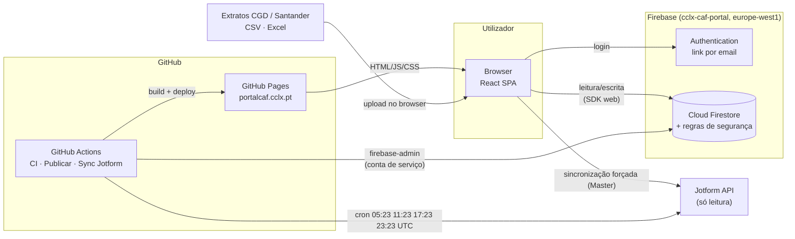
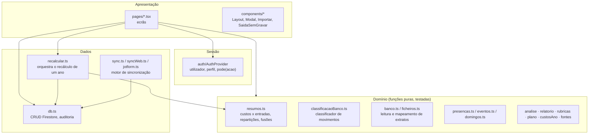
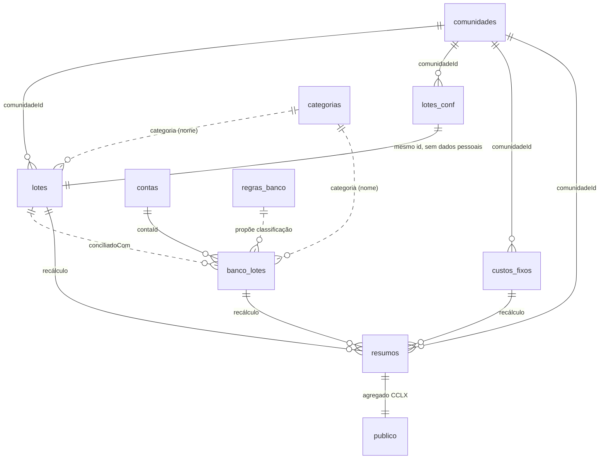
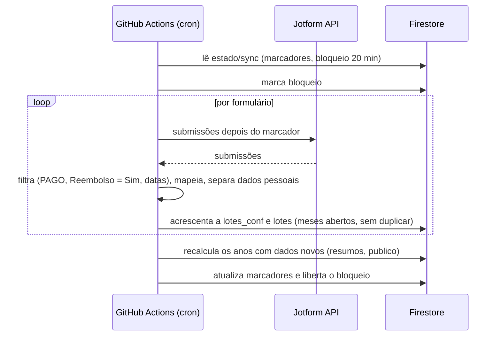
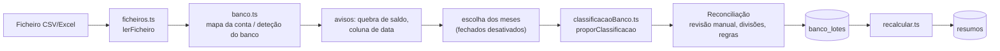
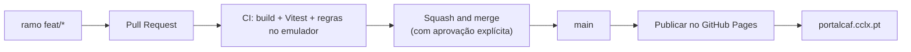

# Portal CAF · Arquitetura técnica

> Documento de referência da arquitetura do Portal CAF da CCLX.
> Estado em 20/11/2026 (main depois do PR #66).
> Repositório: `cclx-pt/poc-portalcaf` · Aplicação: https://portalcaf.cclx.pt/ · Firebase: `cclx-caf-portal`
> As razões de cada escolha estão em [ESCOLHAS-TECNICAS.md](ESCOLHAS-TECNICAS.md).

## 1. Visão geral

O Portal CAF é uma **aplicação web de página única (SPA)** sem servidor aplicacional próprio. Toda a lógica de negócio (classificação de extratos, cálculo de resumos, repartições, previsões) corre **no browser**. Os dados vivem no **Cloud Firestore** e a segurança é imposta pelas **regras do Firestore**, não pelo ecrã.

As únicas peças fora do browser são:

- o **GitHub Pages**, que serve os ficheiros estáticos;
- o **Firebase** (Authentication e Firestore), no plano gratuito Spark;
- uma **tarefa agendada no GitHub Actions**, que lê o Jotform 4 vezes por dia e escreve no Firestore.



### Princípios

| Princípio | Como se aplica |
|---|---|
| Custo zero | Firebase Spark, GitHub Pages e GitHub Actions; sem Cloud Functions nem servidor. |
| Segurança nas regras | Perfis, níveis de privacidade, âmbito por comunidade e meses fechados são verificados em `firestore.rules`. |
| Jotform só de leitura | O portal nunca escreve nem apaga no Jotform. Correções ficam no portal. |
| Cada euro conta uma vez | Movimentos bancários conciliados com o Jotform, ou financeiros, não entram duas vezes nos resultados. |
| Meses fechados imutáveis | Depois do fecho mensal, só o Master altera dados desse mês. |
| Cálculo determinístico | As funções de cálculo em `src/lib` são puras e testadas com Vitest. |

## 2. Stack tecnológica

| Camada | Tecnologia |
|---|---|
| Linguagem | TypeScript 5.9 |
| UI | React 18, React Router 6 (`HashRouter`), lucide-react (ícones), Recharts (gráficos) |
| Build | Vite 6 (`tsc -b && vite build`) |
| Tipografia e identidade | Barlow e Barlow Condensed (`@fontsource`), identidade visual CAF a preto, branco e cinzentos |
| Ficheiros | PapaParse (CSV), ExcelJS (leitura e exportação Excel) |
| Backend gerido | Firebase 11: Authentication (email link) e Cloud Firestore |
| Tarefas | GitHub Actions + `tsx` + `firebase-admin` |
| Testes | Vitest (lógica e páginas com `renderToString`), `@firebase/rules-unit-testing` com o emulador do Firestore |
| Alojamento | GitHub Pages com domínio próprio (`public/CNAME`) |

O `HashRouter` permite alojamento estático sem reescrita de URLs (`https://portalcaf.cclx.pt/#/reconciliacao`).

## 3. Estrutura do código

```
.
├── .github/workflows/
│   ├── ci.yml              # build, testes unitários e testes das regras
│   ├── pages.yml           # publicação no GitHub Pages (push em main)
│   └── sync-jotform.yml    # sincronização agendada Jotform → Firestore
├── firestore.rules         # segurança e privacidade
├── firebase.json           # regras + emulador
├── scripts/
│   └── sync-jotform.ts     # ponto de entrada da tarefa agendada
├── public/                 # logótipos CAF, logótipos dos bancos, CNAME
├── src/
│   ├── main.tsx, App.tsx   # arranque, rotas, proteção por perfil
│   ├── firebase.ts         # inicialização do SDK (config pública)
│   ├── auth/               # AuthProvider: sessão, perfil, permissões
│   ├── components/         # Layout, Modal e UI comum, importação, mapas de extrato, aviso de saída
│   ├── lib/                # lógica de negócio pura + acesso a dados
│   └── pages/              # um ecrã por ficheiro
├── tests/
│   ├── unit/               # Vitest
│   └── rules/              # regras do Firestore no emulador
└── docs/
    ├── ARQUITETURA.md      # este documento
    ├── ESCOLHAS-TECNICAS.md # decisões técnicas e porquê
    └── superpowers/        # especificações e planos de cada fase
```

### 3.1 Camadas no browser



### 3.2 Módulos de domínio (`src/lib`)

| Módulo | Responsabilidade |
|---|---|
| `types.ts` | Modelo de dados partilhado (Comunidade, Conta, Categoria, CustoFixo, Lote, ResumoMes, RegraBanco, etc.). |
| `resumos.ts` | `calcularResumos`: entradas, saídas e resultado por comunidade e mês; custos fixos previstos (`valorImputadoNoMes`, periodicidade); repartição dos gerais e da bolsa geral por peso de assistência (`pesos12m`, `repartir`); fusões de comunidades (`destinoFusao`). |
| `classificacaoBanco.ts` | `proporClassificacao` dos movimentos bancários, conciliação com reembolsos do Jotform, regras com divisões (`resolverPartes`, valor fixo ou %), validação. |
| `banco.ts`, `ficheiros.ts` | Leitura de CSV/Excel, deteção do banco, mapas de colunas por conta, avisos de quebra de saldo. |
| `fontes.ts`, `jotform.ts` | Definição dos formulários Jotform (campos, mapeamento), regras de inclusão (PAGO, "Reembolso necessário? = Sim"), API do Jotform (EU e global). |
| `sync.ts`, `syncWeb.ts` | Motor de sincronização incremental e completa, partilhado pela tarefa agendada e pela sincronização forçada no portal. |
| `presencas.ts`, `eventos.ts`, `domingos.ts`, `rascunhos.ts` | Registo de presenças, configuração de eventos, registos em falta, duplicados, rascunhos locais. |
| `analise.ts`, `relatorio.ts`, `rubricas.ts` | Demonstração de resultados, comparação entre comunidades, relatório custos x entradas. |
| `plano.ts`, `custosPlano.ts`, `custosImport.ts`, `custosAno.ts` | Plano financeiro (rubricas, centros de custo, fornecedores), importação e cópia anual dos custos fixos. |
| `recalcular.ts` | Lê lotes, custos e configuração de um ano, chama `calcularResumos` e grava `resumos` e `publico`. |
| `db.ts`, `uso.ts` | Acesso ao Firestore, auditoria, verificação de uso antes de apagar entidades. |
| `format.ts`, `iban.ts`, `cores.ts`, `imagem.ts` | Formatos pt-PT, validação de IBAN, paleta dos gráficos validada para daltonismo, redução de logótipos. |

## 4. Base de dados (Cloud Firestore)

### 4.1 Tecnologia e localização

| Item | Valor |
|---|---|
| Serviço | Google Cloud Firestore (modo nativo), base `(default)` |
| Projeto | `cclx-caf-portal` |
| Região | `europe-west1` (Bélgica, UE) |
| Plano | Spark (gratuito): 50 000 leituras e 20 000 escritas por dia, 1 GiB guardado |
| Acesso pelo browser | SDK web `firebase/firestore`, sempre sujeito a `firestore.rules` |
| Acesso pela tarefa agendada | `firebase-admin` com conta de serviço (ignora as regras) |
| Outros armazenamentos | Nenhum: o portal não usa Firebase Storage, Realtime Database nem base de dados própria |

O Firestore é uma base de dados de documentos (JSON) agrupados em coleções. Não há tabelas, SQL, chaves estrangeiras nem transações entre coleções: as ligações entre documentos são feitas pelos ids (`comunidadeId`, `contaId`, nome da categoria) e mantidas pela aplicação.

### 4.2 Desenho: lotes mensais

Para caber nos limites do plano gratuito, os dados com muitas linhas não têm um documento por registo. São agrupados em **lotes mensais**: um documento com uma lista `registos`.



Vantagens: ler um ano inteiro custa poucas dezenas de leituras; gravar um mês é uma escrita. Custo: cada gravação substitui o documento do mês inteiro, e cada documento tem o limite de 1 MiB.

### 4.3 Coleções

| Coleção | Id do documento | Conteúdo | Quem lê | Quem escreve |
|---|---|---|---|---|
| `users` | email (minúsculas) | Perfil: papel, nível, comunidades, ativo | Master, CAF, o próprio | Master |
| `comunidades` | id | Nome, ordem, ativo, início/fim, `sucessora` | Ativos | Master, CAF |
| `contas` | id | Conta bancária, IBAN, banco, mapa de colunas do extrato, logótipo (PNG em data URL) | Master, CAF | Master, CAF |
| `categorias` | id | Categoria, rubrica, âmbito (local/geral), privacidade | Ativos | Master, CAF |
| `dimensoes` | `centro-…`, `fornecedor-…`, `conta-…`, `plano-…` | Centros de custo, projetos, fornecedores, contas analíticas | Ativos | Master, CAF |
| `regras_banco` | id | Texto do banco → categoria, comunidade, CC, fornecedor, divisões (`partes`) | Ativos | Master, CAF |
| `lotes_conf` | `{origem}_{AAAA}_{MM}_{comunidade}` | Registos Jotform com dados pessoais | Nível confidencial, no âmbito | Master, CAF, mês aberto |
| `lotes` | o mesmo id | Os mesmos registos sem dados pessoais; presenças do portal | Nível privado, no âmbito; perfil Registos só presenças | Master, CAF (Registos: presenças) |
| `banco_lotes` | `{conta}_{AAAA}_{MM}` | Movimentos de uma conta num mês e a sua classificação | Master, CAF | Master, CAF, mês aberto |
| `custos_fixos` | id | Comunidade, rubrica, valor, incidência, período, periodicidade, nível | Conforme nível e âmbito | Master, CAF |
| `resumos` | `{AAAA}_{comunidade}` | 12 meses calculados por comunidade | Nível privado, no âmbito | Master, CAF |
| `publico` | `{AAAA}` | Visão consolidada pública (meses fechados) | Todos, sem login | Master, CAF |
| `publico_sites` | `{AAAA}` | Contas públicas por comunidade | Ativos | Master, CAF |
| `orcamentos` | `{AAAA}` | Orçamento em vigor | Nível privado | Master, CAF |
| `orcamentos_versoes` | `{AAAA}_v{N}` | Histórico de versões (só criar) | Nível privado | Master, CAF |
| `fechos` | `AAAA-MM` | Estado do fecho mensal | Ativos | Master, CAF |
| `config` | `assistencia`, … | Configuração geral (eventos, tipo de celebração) | Ativos | Master |
| `assistencia_excecoes` | `{AAAA-MM-DD}_{âmbito}` | Datas sem assistência esperada | Ativos | Master, CAF |
| `auditoria` | automático | Ações (quem, ação, detalhe, quando); só acrescentar | Master, CAF | Qualquer ativo, com `quem` = o próprio |
| `segredos` | `jotform` | Chave da API do Jotform e endpoint | Master | Master |
| `estado` | `sync` | Marcadores por formulário e bloqueio da sincronização | Ativos | Master e conta de serviço |

As origens dos lotes são `contribuir`, `depositos`, `despesas` (reembolsos) e `assistencia` (presenças).

### 4.4 Estrutura dos documentos principais

**Lote de origem** (`lotes` / `lotes_conf`)

```ts
{
  id: 'despesas_2026_10_moita',
  origem: 'despesas', ano: 2026, mes: 10, periodo: '2026-10',
  comunidadeId: 'moita',
  total: 1234.56, n: 18,
  atualizadoEm: '2026-11-19T21:08:00Z', atualizadoPor: 'sync',
  apagados?: ['…'],              // presenças: ids apagados no portal (não voltam a ser importados)
  registos: [{
    id: '6123…',                  // id da submissão Jotform ou id gerado no portal
    data: '2026-10-12', valor: 45.9, categoria: 'Material', descricao?: '…', evento?: '…',
    pessoaRef?: 'Contribuinte #A1B2C3',
    extra?: { … },                // campos adicionais (ex.: contagens das presenças, UniqueID)
    // só em lotes_conf:
    pessoa?, nif?, email?, telefone?, iban?
  }]
}
```

**Lote bancário** (`banco_lotes`): os dados dos extratos

```ts
{
  id: 'cgd-principal_2026_10',
  contaId: 'cgd-principal', ano: 2026, mes: 10, periodo: '2026-10',
  atualizadoEm, atualizadoPor,
  registos: [{
    id, data, descricao, valor,   // + crédito, - débito
    saldo?, ordem?, estorno?,
    contabilizar: true,           // entra ou não nos resultados
    conciliadoCom?: 'R20260437',  // registo do Jotform conciliado
    estado?: 'por-classificar' | 'proposto' | 'validado' | 'rever', nota?,
    categoria?, comunidadeId?,    // 'bolsa-geral' para ofertas sem comunidade
    fornecedor?, centroCusto?, projeto?, contaAnalitica?, documento?,
    partes?: [{ comunidadeId, valor, pct?, categoria?, centroCusto?, descricao? }]
  }]
}
```

**Resumo** (`resumos`): um documento por ano e comunidade, com `meses[12]`. Cada mês tem entradas (contribuir, coletas, transferências, quota da bolsa), saídas (custos fixos, despesas), saldo, totais por categoria e por rubrica (parte local e parte recebida dos gerais), peso na repartição, médias de assistência, `previsao` (mês aberto), `cfPrevisto` e `cfGeralPrevisto`.

### 4.5 Onde fica cada tipo de dado

| Dado | Onde fica | Notas |
|---|---|---|
| Movimentos dos extratos | `banco_lotes` | Um documento por conta e mês |
| Ficheiro original do extrato (CSV/Excel) | **Não é guardado** | É lido no browser; só os movimentos vão para o Firestore |
| Mapa das colunas do extrato | `contas` (`mapa`, `mapaColunas`) | Reconhecido automaticamente na importação seguinte |
| Submissões do Jotform | `lotes_conf` e `lotes` | O original continua no Jotform |
| Dados pessoais (nome, NIF, email, telefone, IBAN) | Só `lotes_conf` | `lotes` tem apenas o pseudónimo `pessoaRef` |
| Presenças registadas no portal | `lotes` (origem `assistencia`) | Não vão para o Jotform |
| Rascunhos das contagens | `localStorage` do dispositivo | Por utilizador; apagam-se ao gravar |
| Resultados calculados | `resumos`, `publico`, `publico_sites` | Recriados a cada recálculo |
| Exportações Excel e PDF | **Não são guardadas** | Geradas no browser e descarregadas |

### 4.6 Escrita e consistência

- **Substituição completa**: as gravações usam `setDoc` sem `merge`, por isso o documento é sempre reescrito por inteiro. Quem grava tem de enviar o objeto completo. Com `ignoreUndefinedProperties`, campos opcionais vazios são omitidos.
- **Lotes em par**: `lotes_conf` e `lotes` gravam-se no mesmo `writeBatch`, para não ficarem desalinhados.
- **Recálculo**: `recalcularAno` grava todos os `resumos` de um ano e o `publico` num `writeBatch`.
- **Concorrência**: não há bloqueio otimista. Se duas pessoas gravarem o mesmo mês da mesma conta ao mesmo tempo, fica a última gravação. A sincronização tem um bloqueio próprio de 20 minutos em `estado/sync`.
- **Meses fechados**: as regras recusam escritas em `lotes`, `lotes_conf` e `banco_lotes` de um período com `fechos/{AAAA-MM}.estado = 'fechado'`, exceto ao Master.
- **Auditoria**: as ações relevantes (importações, alterações de configuração, correções de presenças com valor antigo → novo) são acrescentadas em `auditoria`, que as regras não deixam alterar nem apagar.
- **Índices**: as consultas filtram por um só campo (`ano`, `origem`), cobertas pelos índices automáticos. Não há `firestore.indexes.json`.

### 4.7 Cópias de segurança e retenção

- O plano Spark **não tem cópias de segurança automáticas** nem recuperação para um momento anterior (PITR).
- Os dados de origem do Jotform podem ser recriados com "Reler tudo". **Os movimentos bancários classificados, a reconciliação, as regras, os custos fixos, o orçamento e as presenças registadas no portal não existem em mais lado nenhum.**
- Os resumos podem ser recriados a qualquer momento com "Recalcular resumos".
- Não há regra de retenção: os dados ficam até serem apagados no portal.

Recomendação: exportação periódica (por exemplo, mensal, depois do fecho) com `gcloud firestore export` (exige plano Blaze e um bucket) ou um script com `firebase-admin` agendado no GitHub Actions que guarde um JSON das coleções críticas num local privado.

### 4.8 Limites a vigiar

| Limite | Situação |
|---|---|
| 1 MiB por documento | Um lote bancário ou de origem com milhares de linhas num só mês pode aproximar-se do limite. |
| 500 operações por `writeBatch` | Folgado com o número atual de comunidades e contas. |
| Quotas diárias do Spark | O recálculo de um ano e a sincronização completa são as operações mais pesadas. |
| Pseudónimos | `pessoaRef` é um SHA-256 truncado a 6 caracteres com sal fixo no código. Serve para agrupar, não para proteger contra quem tenha acesso de leitura ao nível privado e queira reverter NIFs. |

## 5. Autenticação, perfis e privacidade

### 5.1 Login

- **Só link por email** (Firebase Email Link, sem senhas). O login Google foi retirado.
- `auth.languageCode = 'pt-PT'`: os emails do Firebase saem em português.
- Ao criar um utilizador, o portal envia o email de acesso (`sendSignInLinkToEmail`); há também o botão "Enviar email de acesso".
- Só entra quem tem perfil ativo em `users` ou é Master (lista fixa nas regras). O email tem de estar verificado.

### 5.2 Perfis

| Perfil | Âmbito | Ações principais |
|---|---|---|
| Master | Toda a CCLX | Tudo, incluindo configuração geral, segredos e meses fechados |
| CAF | Toda a CCLX | Entidades, custos fixos, bancos, reconciliação, orçamento, fecho, exportação |
| Tesoureiro | A sua comunidade | Consulta |
| Leitura | Comunidades atribuídas | Consulta até ao nível definido |
| Registos | Comunidades atribuídas | Só presenças (link direto `#/registar`) |

As permissões existem em dois sítios, com papéis diferentes:

1. **`AuthProvider` (`pode(acao)`) e `<Se>` em `App.tsx`**: decidem que menus e ecrãs aparecem. É conveniência de interface.
2. **`firestore.rules`**: decidem o que pode ser lido e escrito. É a barreira real, testada em `tests/rules`.

### 5.3 Níveis de privacidade

| Nível | Conteúdo |
|---|---|
| Público | Só totais de meses fechados; grupos com menos de 3 registos escondidos; vencimentos dentro de "Custos de funcionamento" |
| Privado | Detalhe com pseudónimos; sem nomes, NIF, email ou IBAN |
| Confidencial | Tudo |

## 6. Fluxos de dados

### 6.1 Sincronização com o Jotform



- **Incremental** (por defeito): só submissões novas; os últimos 30 dias do CONTRIBUIR são sempre relidos.
- **Completo** ("Reler tudo"): relê desde a data de referência e substitui os lotes dos meses abertos. Nas presenças, só acrescenta registos novos e respeita os apagados.
- **Sincronização forçada**: o Master corre o mesmo motor a partir do portal (`syncWeb.ts`), com a chave guardada em `segredos`.
- A tarefa agendada autentica com uma **conta de serviço** guardada no segredo `FIREBASE_SERVICE_ACCOUNT` do GitHub; a conta de serviço não passa pelas regras.

### 6.2 Extratos bancários e reconciliação



Ordem do classificador (`proporClassificacao`):

1. Estornos e IFTHENPAY
2. Ofertas para a comunidade Geral (TFI, Trf. MB WAY, Trf.Imed); DIZIMO vai para R1.01
3. Código de reembolso (R…) conciliado com o Jotform
4. Depósitos
5. Segurança Social e vencimentos (por valor mensal total do grupo de pagamento)
6. Memória (classificações anteriores do mesmo texto)
7. Regras de texto, incluindo divisões em várias linhas (valor fixo ou percentagem)
8. Restantes transferências → Geral

### 6.3 Cálculo dos resumos

`recalcularAno` lê, para um ano, os lotes, os movimentos bancários, os custos fixos, as comunidades, as categorias e a configuração. Depois chama `calcularResumos` e grava um documento `resumos/{ano}_{comunidade}` por comunidade, mais `publico/{ano}`.

Regras principais:

- **Entradas** = Contribuir + coletas depositadas + transferências atribuídas + quota da bolsa geral.
- **Saídas** = custos fixos + despesas e reembolsos do Jotform + débitos bancários a contabilizar.
- **Meses fechados** usam valores reais; **meses abertos** mostram a previsão dos custos fixos, respeitando a periodicidade de cada custo.
- **Gerais e bolsa geral** são repartidos pelas comunidades ativas na proporção da média de jovens e adultos dos últimos 12 meses (por ocorrência do evento de celebração).
- **Fusões**: depois do `fim` de uma comunidade, os seus registos e custos passam para a `sucessora` (ex.: Barreiro → Moita) e o histórico soma ao peso da sucessora.

O recálculo é disparado pelo botão "Recalcular resumos" no Painel, pelo Fecho mensal, pela sincronização (tarefa agendada e forçada), por alterações na Configuração que mexem nas repartições e pela gravação de presenças (quando o perfil pode recalcular). A tarefa agendada usa as mesmas funções puras (`calcularResumos`, `calcularPublico`) com o `firebase-admin`.

### 6.4 Presenças

- Os registos feitos no portal entram nos mesmos lotes mensais da origem `assistencia` que os do Jotform.
- Contagens em branco gravam 0. Os duplicados (mesmo dia, evento e comunidade) são assinalados.
- Os eventos com contagem obrigatória geram "Registos em falta" a partir da data "Obrigatório desde", exceto nas datas sem assistência esperada.
- Os rascunhos ficam em `localStorage`, por utilizador, até à gravação.

## 7. Comportamentos transversais de interface

- **Aviso ao sair sem gravar** (`components/SaidaSemGravar.tsx`): um provider intercepta, na fase de captura, os cliques em ligações `#/…` enquanto algum ecrã registado tem alterações pendentes. Pergunta "Gravar e sair", "Sair sem gravar" ou "Ficar" e acrescenta o aviso `beforeunload`. Os ecrãs aderem com `useAvisoSaida(sujo, gravar)`, onde `gravar` devolve `true` se gravou. Hoje: Reconciliação, Registar presenças e Orçamento. É necessário porque o `HashRouter` não suporta `useBlocker`.
- **Erros a amarelo e foco no primeiro campo com erro** (`.aviso`, `.com-erro`, `useFocarErro`; o Modal observa `.aviso` com um `MutationObserver`).
- **Formatos**: datas dd/mm/aaaa, valores em € com duas casas decimais e separadores portugueses (`format.ts`).
- **Gráficos**: Recharts com paleta própria validada para daltonismo (`cores.ts`); o resto da interface segue a identidade CAF.

## 8. Entrega contínua



| Workflow | Disparo | O que faz |
|---|---|---|
| `ci.yml` | PR e push em main | `npm run build`, `npm test`, `npm run test:rules` (emulador Firestore, Java 21) |
| `pages.yml` | Push em main, manual | Build Vite e deploy no GitHub Pages |
| `sync-jotform.yml` | Cron 4x/dia, manual (incremental ou completo, data de referência) | `npx tsx scripts/sync-jotform.ts` com a conta de serviço |

Regras de trabalho: um ramo por funcionalidade, PR com descrição, squash and merge só com aprovação, sem force-push. As regras do Firestore não são publicadas pelo CI: publicam-se à parte com `npx firebase deploy --only firestore:rules` ou na consola.

## 9. Testes

| Tipo | Onde | Cobre |
|---|---|---|
| Lógica | `tests/unit/*.test.ts` | Resumos, gerais e fusões, custos fixos e periodicidade, classificador e divisões, mapas de extrato, sincronização, presenças, eventos, domingos, rubricas, relatório |
| Páginas | `tests/unit/*.test.tsx` | Render das páginas com dados simulados (`renderToString`, `MemoryRouter`) |
| Segurança | `tests/rules/firestore.rules.test.ts` | Leitura e escrita por perfil, nível, âmbito e mês fechado |

Estado atual: 213 testes unitários a passar.

## 10. Limites conhecidos e riscos

| Tema | Situação | Mitigação ou evolução |
|---|---|---|
| Cálculo no cliente | O recálculo de um ano lê muitos documentos e corre no browser de quem o pede. | Aceitável com o volume atual; numa fase 2 pode passar para a tarefa agendada ou para Cloud Functions (plano Blaze). |
| Tamanho do bundle | Cerca de 1,5 MB (400 KB gzip) mais ExcelJS em separado; primeiro carregamento lento em redes fracas. | Divisão de código por rota (`React.lazy`). |
| Limite de 1 MiB por documento | Lotes mensais por comunidade crescem com o volume. | Monitorizar; dividir lotes se necessário. |
| Sem cópias de segurança | O plano Spark não faz backups; parte dos dados só existe no Firestore. | Exportação periódica (ver 4.7). |
| Permissões duplicadas | `AuthProvider` e `firestore.rules` têm de estar alinhados. | Testes das regras no CI; rever ambos em cada alteração de perfis. |
| Chave do Jotform | Guardada em `segredos`, lida pelo browser do Master para a sincronização forçada. | Só Master; rodar a chave se houver suspeita. |
| Conta de serviço | Segredo no GitHub com acesso total ao Firestore. | Acesso restrito ao repositório; rodar periodicamente. |
| Recálculo manual | Algumas alterações (custos fixos, periodicidade) só se refletem depois de "Recalcular resumos". | Recálculo automático após gravação, ou indicador de resumos desatualizados. |
| Modelo de repartição | Regras de repartição e fusões estão em código. | Fase 2: modelar e configurar as regras de distribuição no portal. |

## 11. Glossário

| Termo | Significado |
|---|---|
| Comunidade | Local da CCLX; "Geral" é a comunidade financeira da igreja toda (não aparece nos registos) |
| Bolsa geral | Ofertas sem comunidade, distribuídas pela assistência |
| Gerais | Custos e proveitos de âmbito geral, repartidos por média proporcional de assistência |
| Lote | Documento mensal com os registos de uma origem e comunidade |
| Resumo | Resultado calculado por comunidade e mês |
| Fecho | Bloqueio de um mês; só o Master altera depois |
| Sucessora | Comunidade que recebe os registos e custos de outra depois do seu fim |
