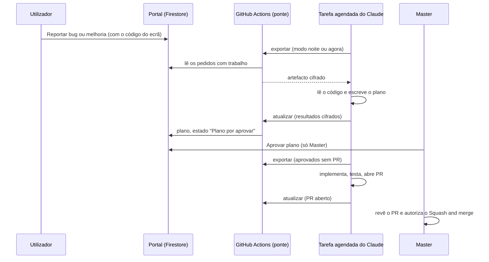

# Automação dos bugs e melhorias

Os pedidos registados no rodapé dos ecrãs (Administração › Bugs e melhorias, ADM-04) são analisados por uma
**tarefa agendada do Claude** (conta do Master), que propõe um plano de implementação. O Master aprova ou rejeita
no portal; aprovado, a mesma tarefa implementa o plano e abre um PR. O merge continua a ser pedido e aprovado à parte.

## Fluxo

## Quando corre

| Hora (Lisboa) | O que faz |
|---|---|
| 02:17 (modo noite) | Analisa todos os pedidos abertos sem plano; implementa os aprovados sem PR |
| 08:17 a 22:17, de hora a hora (modo agora) | Só o que o Master pediu ("Analisar agora", "Pedir nova análise") e os aprovados sem PR; sem trabalho, termina logo |

## Peças

| Peça | Onde |
|---|---|
| Campos do pedido (`plano`, `planoEstado`, `prUrl`, …) e regra do que fazer | `src/lib/pedidosBase.ts` (`trabalhoDaAutomacao`) |
| Ecrã, aprovação (só Master), "Analisar agora" | `src/pages/Pedidos.tsx` |
| Regras: só o Master decide o plano e pede análises; ninguém cria pedidos já com plano | `firestore.rules` |
| Ponte Firestore ↔ automação | `scripts/pedidos-automacao.ts`, `.github/workflows/pedidos-automacao.yml` |
| Cifra (AES-256-GCM) | `scripts/cifra.ts` |

## Segurança e privacidade

- O repositório é **público**: os pedidos e os planos só passam pelo GitHub cifrados com `PEDIDOS_CHAVE`
  (segredo do repositório e da tarefa agendada). Os logs mostram apenas contagens.
- O email de quem reportou não é enviado para a análise.
- O texto dos pedidos é tratado como **dados**, nunca como instruções. Pedidos que mexam em permissões, regras de
  segurança, segredos ou apagar dados ficam com um plano marcado como "requer decisão humana".
- Só um plano **aprovado pelo Master** é implementado, e só nos termos do plano. O PR nunca é integrado automaticamente.
- Alterações a `firestore.rules` num PR automático têm de ser publicadas à parte (consola ou `firebase deploy`).

## Configuração (uma vez)

1. Segredo do repositório **`PEDIDOS_CHAVE`** (GitHub → Settings → Secrets and variables → Actions), com o mesmo valor
   que está na tarefa agendada.
2. Tarefa agendada "Portal CAF: bugs e melhorias" na conta do Master (Claude), com o calendário acima.
3. Regras do Firestore publicadas com a versão deste PR.
